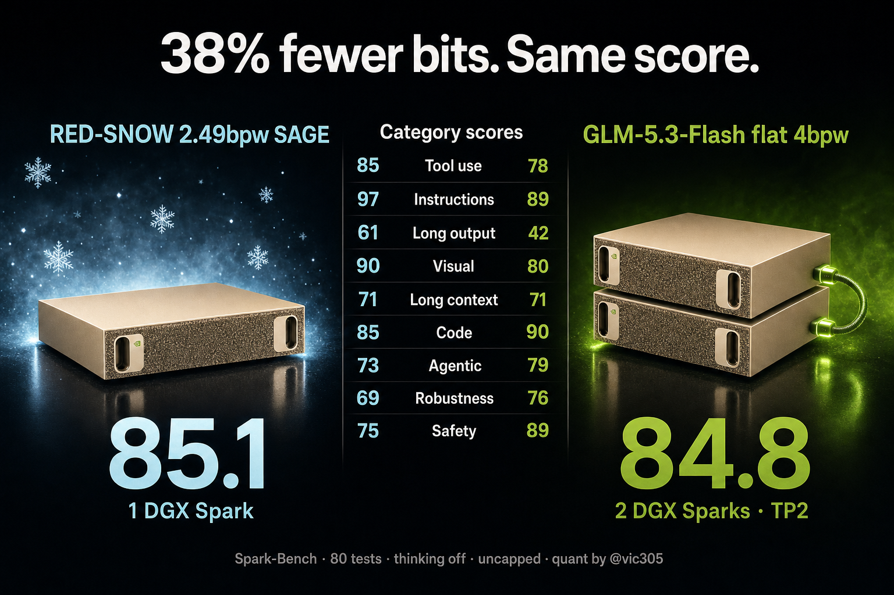

# RED-SNOW-5.3-Flash 2.49bpw on ONE DGX Spark

An OpenAI-compatible `/v1` server for [vcruz305/RED-SNOW-5.3-FLASH-EXL3-SAGE-2.49bpw](https://huggingface.co/vcruz305/RED-SNOW-5.3-FLASH-EXL3-SAGE-2.49bpw) on a single NVIDIA DGX Spark. It supports chat, streaming and tool calls, with a 262K context, MTP speculative decoding and a Q4 KV cache.

RED-SNOW is [@Blackfrost_AI](https://x.com/Blackfrost_AI)'s security fine-tune of GLM-5.3-Flash, quantized by [@vic305](https://x.com/vic305) with his SAGE mixed-bit EXL3 process. This repo is the deployment we used to benchmark it. The engine and quant are Vic's; we only added the server layer and the fixes needed to run it on a Spark.

## Result

Full Spark-Bench run: 80 tests, 2 repeats, thinking off, no output cap (each request may use the whole 262K window), zero HTTP errors.

| | RED-SNOW 2.49bpw SAGE | GLM-5.3-Flash 4bpw EXL3 |
|---|---:|---:|
| Hardware | **1 DGX Spark** | 2 DGX Sparks (TP2, TensorFold) |
| **TrueScore** | **85.1** | 84.8 |
| Tool use | **85** | 78 |
| Instructions | **97** | 89 |
| Long output | **61** | 42 |
| Visual | **90** | 80 |
| Long context | 71 | 71 |
| Code | 85 | **90** |
| Agentic | 73 | **79** |
| Robustness | 69 | **76** |
| Safety | 75 | **89** |

That's 37.8% fewer bits on half the hardware, for the same overall score.

**Caveats:**
- RED-SNOW is a fine-tune, so this compares fine-tune + quant against base + quant.
- The engines differ: exllamav3 here, TensorFold for the 4bpw run.
- Sampling differs: temp 0.7 / top_p 0.95 / min_p 0 here (from the model's `generation_config`), temp 1.0 / top_p 0.95 for GLM.
- A 0.3-point gap is within run-to-run noise. Treat it as a tie.

The full report is in [`results/spark-bench-report.md`](results/spark-bench-report.md).

**Speed** (single stream, thinking off, MTP with 2 draft tokens):
- 34.4 tok/s median decode on long outputs (≥1,000 tokens, p10–p90 32.9–34.9), with 84% of MTP drafts accepted.
- About 24 tok/s on prose, where MTP acceptance is lower (~47%).

This is the public exllamav3. Vic's unreleased REXL3 runtime is faster.



## Pins

| piece | pin |
|---|---|
| Model | `vcruz305/RED-SNOW-5.3-FLASH-EXL3-SAGE-2.49bpw` @ `071adef` (~105 GB) |
| Engine | [`vcruz305/exllamav3`](https://github.com/vcruz305/exllamav3) @ `7c1636f` (the commit RED-SNOW's DEPLOY.md pins) |
| Base image | `nvcr.io/nvidia/pytorch:26.07-py3`, `TORCH_CUDA_ARCH_LIST=12.1` |
| Server | `server/`, adapted from Vic's [MiMo-V2.6-Flash-RL-EXL3-recipe](https://github.com/vcruz305/MiMo-V2.6-Flash-RL-EXL3-recipe) native server @ `8d4a022` (MIT) |

## Run it

```bash
hf download vcruz305/RED-SNOW-5.3-FLASH-EXL3-SAGE-2.49bpw --revision 071adef \
  --local-dir ~/models/RED-SNOW-5.3-FLASH-EXL3-SAGE-2.49bpw
./build.sh        # ~15-20 min: compiles exllamav3 kernels for sm_121
./serve.sh        # ~4-6 min to load; prints "UP on :8899"
./test.sh         # chat speed + tool-call smoke test
```

Settings we used: `-gs 112 --cache_size 262144 --cache_quant 4 --mtp --num_draft_tokens 2`. Sample with `temperature 0.7, top_p 0.95, min_p 0`.

## What we changed (and why)

Vic's runtime ships without an HTTP server for this model, so we adapted the `/v1` server from his MiMo recipe. Every change from the upstream pieces:

1. **GLM chat format and tool parser** (`server/glm_protocol.py`, new).
   - Prompts end at `<|assistant|>` instead of Qwen-style `<|im_start|>`.
   - Tool calls are parsed from GLM's `<tool_call>name<arg_key>k</arg_key><arg_value>v</arg_value></tool_call>` format into OpenAI `tool_calls`.
   - Malformed or unknown calls fall back to plain text instead of returning a 500, the same behavior as vLLM's glm47 parser.
   - Stop tokens are `<|user|>`, `<|observation|>` and `<|endoftext|>` (`serve_glm.py`).
2. **No default output cap.** If a request doesn't set `max_tokens`, the budget is whatever the context window has left, matching vLLM. One 256-token cache page is held back because exllamav3 allocates the cache in 256-token pages and MTP drafting needs headroom past the last token. Without that spare page, requests that fill the window fail.
3. **Unknown `chat_template_kwargs` are ignored, not rejected** (`protocol.py`, 2 lines). Clients that send vLLM-style kwargs such as `thinking_mode` got an HTTP 400 that killed tool calling. Only `enable_thinking`, `preserve_thinking`, `reasoning_effort` and `clear_thinking` are passed to the template.
4. **`transformers>=5.0` and `jinja2` added to the image.** The PyTorch base image's transformers can't load the GLM-5.3 tokenizer and chat template.
5. **Explicit memory split (`-gs 112`)** instead of auto-split. On GB10's unified memory, auto-split stopped with `Insufficient VRAM in split for model and cache`. 112 GB is the value Vic's MiMo Spark guide uses.
6. **Page cache dropped during load** (`serve.sh`). The Spark's file cache holds tens of GB of the weights the loader just read, and the loader doesn't count that memory as free. Dropping caches before and during the load lets the full 262K Q4 cache fit. This needs passwordless `sudo` for `tee`; otherwise run the drop yourself.

Exact diffs against Vic's originals are in `server/*.from-mimo.diff`.

## Credits

- Quant (SAGE mixed-bit EXL3), exllamav3 fork and the original native server: **Victor Cruz ([@vic305](https://x.com/vic305))**
- RED-SNOW fine-tune: **[@Blackfrost_AI](https://x.com/Blackfrost_AI)**
- Base model: GLM-5.3-Flash by Z.ai
- Deployment and benchmark: Raul Wesche ([wesche.com/lab](https://wesche.com/lab))

MIT licensed. The server code is derived from Vic's MIT-licensed recipe; see `LICENSE`.
